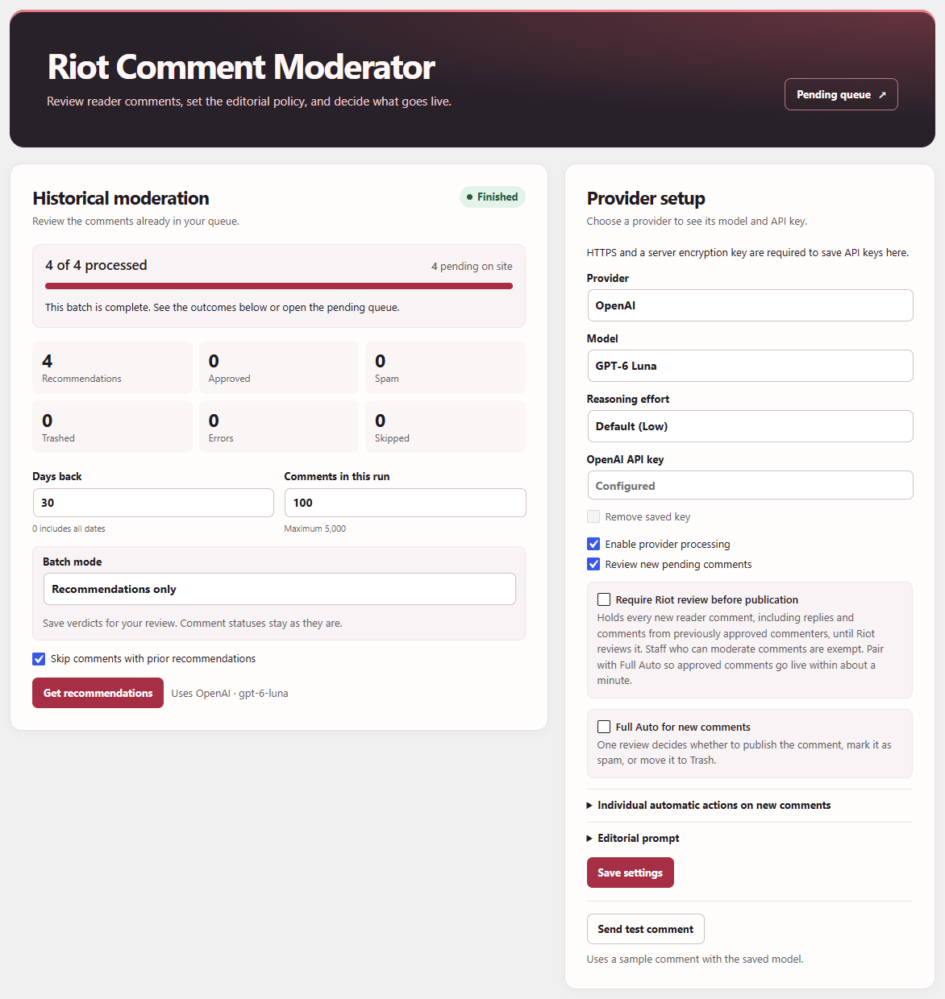
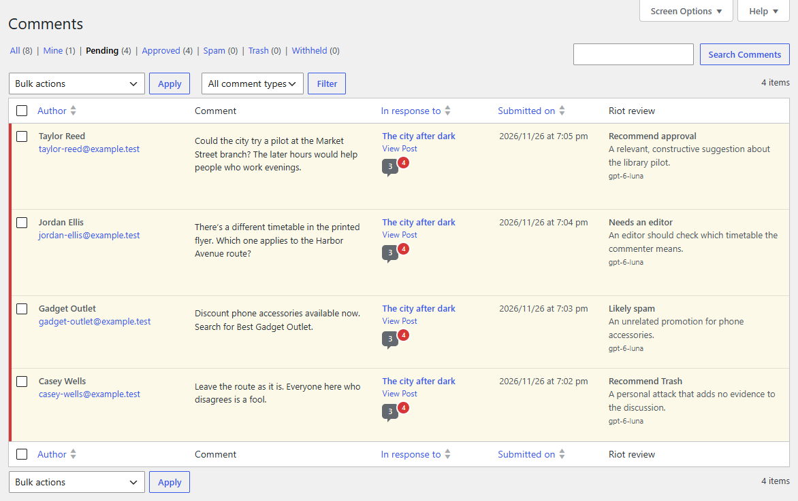

# Riot Comment Moderator

Review pending WordPress comments with OpenAI or OpenRouter. Keep recommendations for editors or let the plugin act on selected decisions. Riot Comment Moderator works with Riot Comments and the native WordPress comment form.

**WordPress 6.3+** · **PHP 7.4+** · **MIT**



## Install

1. Download `riot-comment-moderator.zip` from the [latest release](https://github.com/riotrequest/riot-comment-moderator/releases/latest).
2. Upload the ZIP under **Plugins → Add New Plugin → Upload Plugin** and activate it.
3. Open **Comments → Riot Moderator**, select a provider, and configure its key. Use **Send test comment** to check the connection before enabling processing.

Provider keys are set through the WordPress dashboard over HTTPS with encrypted storage configured, or supplied through private server configuration. Setup, background processing, and data handling are covered in [readme.txt](readme.txt).

## Review recommendations

Open **Comments → Pending** to see each recommendation and its reason in the **Riot review** column.



## Update from WordPress

Upload version 1.3.10 or later once to an older install and choose **Replace current with uploaded**. After that, WordPress offers new stable GitHub releases under **Plugins** and **Dashboard → Updates** while Riot Comment Moderator is active in `wp-content/plugins/riot-comment-moderator/`. WordPress can install them automatically if you choose **Enable auto-updates** on the Plugins screen.

Update checks use the public GitHub Releases API and require no GitHub credentials.

## Publish a release

Update the version in the main PHP file and in [readme.txt](readme.txt), then commit and tag it with the matching `vX.Y.Z`. Build the ZIP from that tag, push the commit and tag, then attach the ZIP to the stable release. Keep the archive and asset names shown below.

```sh
tag=v1.3.10
git archive --format=zip --prefix=riot-comment-moderator/ -o ../riot-comment-moderator.zip "$tag"
gh release create "$tag" ../riot-comment-moderator.zip --verify-tag --latest --generate-notes
```

## License

MIT. See [LICENSE](LICENSE).
